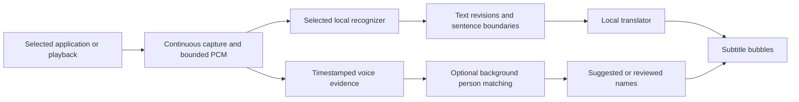

# Codebase guide

This guide explains the components, the order they run in and where to start
reading. For the user-visible settings, see the [settings reference](settings-reference.md).
For a checkout you can build, see [development](development.md).

## Three different AI jobs

Speech recognition turns audio into words. Translation turns those words into
another language. Person recognition compares a voice with saved, reviewed
examples to suggest a name. These are different models with different inputs.
Changing the translator does not repair words that the speech recognizer already
misheard. A saved person's voice example does not teach the translation model.

The main feature sends **your own microphone** to VRChat chat. Optional live
subtitles listen to **incoming playback** and display translations locally.
They have separate capture, speech-model and language choices, and can run
independently. They can share one resident translation model to save memory.

## Your voice to VRChat

The dashboard starts only the requested feature. It prepares missing files before
changing an active session and retains references to the processes it owns.
The capture host handles microphone frames, speech-turn boundaries, streaming
recognition, speculative translation and authoritative final output.

A brief pause marks a message boundary. Optional early messages let readers see
an evolving translation sooner; they are submitted chat messages, not edits to
VRChat's open input box. The output proxy rejects stale/cancelled revisions and
applies the chatbox's short-message limits. Multiple target languages divide that
same display budget and add translation work.

Mute status and the decision to follow it are separate. By default the controller
keeps capture closed until it has verified VRChat's status. The Home preference
can explicitly allow translation while VRChat's microphone is muted. Speech
captured before muting can finish according to its separate preference. A game
exit or reconfiguration freeze still prevents new capture.

Start reading:

| Responsibility | Source |
|---|---|
| Home controls and immediate own-voice choices | [VoiceFirstHome.cs](../LocalTalk/VoiceFirstHome.cs), [MainWindow.VoiceFirstRuntime.cs](../LocalTalk/MainWindow.VoiceFirstRuntime.cs) |
| Feature startup, process ownership, shared translator planning and shutdown | [RuntimeController.cs](../LocalTalk/RuntimeController.cs) |
| Mute/presence discovery, capture policy and drain coordination | [FoxTrans-VRChatMuteSync.ps1](../FoxTrans-VRChatMuteSync.ps1) |
| Headless capture and per-turn scheduling | [FoxTransLocalHost/Program.cs](../FoxTransLocalHost/Program.cs) |
| Streaming protocol adapters | [NemotronTranscriber.cs](../FoxTransSource/FoxTrans/Providers/NemotronTranscriber.cs), [VoxtralFoxTranscriber.cs](../FoxTransSource/FoxTrans/Providers/VoxtralFoxTranscriber.cs) |
| Translation request formats and model restrictions | [TranslationModelPrompts.cs](../FoxTransSource/FoxTrans/Providers/TranslationModelPrompts.cs), [TranslationModelCapabilities.cs](../FoxTransSource/FoxTrans/Providers/TranslationModelCapabilities.cs) |
| OSC ordering, finalization and display formatting | [FoxTrans-OscSentenceProxy.ps1](../FoxTrans-OscSentenceProxy.ps1) |

## Incoming live subtitles

The audio source can be VRChat, another selected application, or desktop
playback. Process capture follows the selected process rather than recording all
other applications. The PCM stream is downmixed/resampled for recognition.
Capture continues while decoding and translation work run; guessing that a voice
has become quiet must not stop the capture device from hearing the next sentence.

Normal/Quick subtitle recognition currently offers:

| Recognizer | Audio-language control | Execution |
|---|---|---|
| Nemotron | Automatic or an explicitly supported source language, passed to the actual decoder session | Owned native Windows process |
| FireRedASR2 Fast | Chinese/English specialist, CTC branch | Local ONNX inference on two CPU threads |
| FireRedASR2 Accurate | Chinese/English specialist, AED encoder plus decoder | Local ONNX inference on two CPU threads |
| Voxtral | Automatic audio-language detection | App-managed or registered WSL server |

FireRedASR2 is not a word-by-word streaming decoder. SayWhat uses short,
incrementally decoded audio sections, emits provisional revisions and finalizes
at the chosen pause or a bounded section length. Choosing Chinese selects that
specialist and supplies translation context; FireRed has no forced-language
argument and can still recognize English inside Chinese speech. Its two variants
are genuine second-generation conversions, with immutable file revisions and
checksums. See [models and runtimes](models-and-runtimes.md).

The main incoming service is split across partial-class files. This keeps the
original pipeline and its newer backends in one service lifetime while separating
the protocols and policies:

| Responsibility | Source |
|---|---|
| Overlay, incoming service, capture pump, settlement and translation publication | [Program.Fixed.cs](../IncomingTranslator/Program.Fixed.cs) |
| Supported recognition models and audio-language capabilities | [IncomingRecognitionCatalog.cs](../IncomingTranslator/IncomingRecognitionCatalog.cs) |
| Native Nemotron handshake, event parsing and cumulative transcript state | [IncomingNativeSpeech.cs](../IncomingTranslator/IncomingNativeSpeech.cs) |
| FireRed verified downloads and ONNX setup | [FireRedSpeechProvisioner.cs](../LocalTalk/FireRedSpeechProvisioner.cs), [SherpaSpeechRecognizer.cs](../LocalTalk/SherpaSpeechRecognizer.cs) |
| FireRed audio sections, coalesced drafts, final queue and decode lifetime | [FireRedIncomingSpeech.cs](../LocalTalk/FireRedIncomingSpeech.cs) |
| Bounded audio and recognition recovery policy | [IncomingContinuousAudio.cs](../IncomingTranslator/IncomingContinuousAudio.cs) |
| Sentence-sized revisions instead of one endless bubble | [SubtitleSegmentation.cs](../IncomingTranslator/SubtitleSegmentation.cs) |
| Independent text and person-matching work | [IncomingPipelineProfiles.cs](../IncomingTranslator/IncomingPipelineProfiles.cs) |
| Source application and one-person listening | [IncomingListening.cs](../IncomingTranslator/IncomingListening.cs), [IncomingListeningPipeline.cs](../IncomingTranslator/IncomingListeningPipeline.cs) |
| Windows per-process playback capture | [ProcessLoopbackCapture.cs](../IncomingTranslator/ProcessLoopbackCapture.cs) |

## Groups and overlapping voices

Groups is a different speech backend, not a faster person-identification model.
VibeVoice returns attributed transcript segments with timestamps and temporary
voice labels. SayWhat retains a bounded audio timeline and can relate suitable
segments back to the audio it already captured. Clean evidence can then be
compared with saved people. Mixed or uncertain evidence must not automatically
become a training example.

VibeVoice's temporary voice label is not a saved person's identity. Manual
corrections remain authoritative. The app does not have individual VRChat player
audio feeds, and normal fingerprint matching does not extract overlapping voices
into separate recordings. Groups can help produce attributed text but cannot
guarantee that every simultaneous speaker is recovered or correctly named.

Read [IncomingGroupPipeline.cs](../IncomingTranslator/IncomingGroupPipeline.cs),
[GroupSpeechClient.cs](../IncomingTranslator/GroupSpeechClient.cs),
[VibeVoiceRuntime.cs](../LocalTalk/VibeVoiceRuntime.cs) and
[the local server adapter](../Packaging/vibevoice/README.md).

## People, corrections and generated avatars

Person matching runs behind text publication so an expensive or failed match
does not hold a finished translation hostage. Jobs retain the audio and identity
epoch they belonged to. Late results may update the name on the current bubble,
but cannot overwrite newer text, resurrect a deleted person or override a manual
correction.

An automatic suggestion does not reinforce itself. Accepted clean examples add
local voice fingerprints; corrections/rejections affect future matching and
review statistics. This updates local examples and matching rules, not the neural
model's weights. The one-person mode uses the name supplied by the user without
pretending that this assumption is confirmed voice evidence.

The larger People picture and smaller subtitle thumbnail are separate display
sizes. User-supplied pictures pass through explicit file/paste, cropping and
bounded image processing. Generated artwork uses a stable local person/voice
seed; it does not send a voice to an image service.

Read [AiSpeakerIdentifier.cs](../IncomingTranslator/AiSpeakerIdentifier.cs),
[SpeakerFeedback.cs](../IncomingTranslator/SpeakerFeedback.cs),
[IncomingSpeakerReviews.cs](../IncomingTranslator/IncomingSpeakerReviews.cs),
[PeopleUi.cs](../LocalTalk/PeopleUi.cs),
[PersonPhotoEditor.cs](../LocalTalk/PersonPhotoEditor.cs) and
[GeneratedPersonAvatar.cs](../IncomingTranslator/GeneratedPersonAvatar.cs).

## Settings and runtime changes

[AppSettings.cs](../IncomingTranslator/AppSettings.cs) defines stored choices,
defaults, copying, normalization and compatibility migration. UI language,
appearance, capture, recognition and translation settings are distinct.

Changing a label or timing should not unnecessarily unload a model. A different
audio source or spoken language may need a fresh service/session so old PCM and
context cannot cross into the new selection. A new model needs controlled
stop/start with rollback if the replacement fails. Downloads happen before an
active session is paused. Idle settings changes must leave inference idle.

The planning is in [RuntimeProfiles.cs](../LocalTalk/RuntimeProfiles.cs) and
[MainWindowProfileRuntime.cs](../LocalTalk/MainWindowProfileRuntime.cs).
[TranslationProfiles.cs](../IncomingTranslator/TranslationProfiles.cs) defines
built-ins/custom snapshots; the UI's pending-versus-saved state is in
[MainWindow.SaveState.cs](../LocalTalk/MainWindow.SaveState.cs). Targeted preference
writes prevent a stale subtitle window from overwriting newer model or language
choices elsewhere.

## Why queues, timestamps and ownership matter

- Audio, text and identity work have different costs. Keeping them independent
  prevents a slow name lookup from appearing to stop listening.
- Drafts are replaceable. A newer draft should supersede old speculative work;
  a completed sentence must not be silently cancelled by a newer preview.
- Unbounded queues turn a brief slowdown into minutes of delay. Bounded queues
  need explicit drop/backlog feedback and must reject stale results afterward.
- Speaker evidence follows captured-audio timestamps, not the wall-clock time
  when a delayed transcript arrives. Missing audio must not be treated as a clean
  continuous example.
- A live socket does not prove that useful words are being recognized. Health
  tracks capture, decoder progress, meaningful words, translation and display.
- Shutdown owns exact process references and verified WSL ownership tokens. It
  must not kill an unrelated server because it happens to occupy a familiar port.

The regression files beside these components exercise these invariants using
synthetic audio/text and isolated state. Test names are often the quickest way to
understand why a guard exists.

## Setup, downloads, updates and installation

[Provisioning.cs](../LocalTalk/Provisioning.cs),
[NativeSpeechProvisioner.cs](../LocalTalk/NativeSpeechProvisioner.cs) and
[AutomaticSetup.cs](../LocalTalk/AutomaticSetup.cs) prepare selected tools and
models. Download metadata pins identity, size and digest; preparation is separate
from loading a model. WSL is optional for the native path, not a prerequisite for
every user.

[AppUpdateChecker.cs](../LocalTalk/AppUpdateChecker.cs) reads bounded update
metadata; [AppUpdateInstaller.cs](../LocalTalk/AppUpdateInstaller.cs) verifies a
download before the installer handoff. The installer requests a graceful
shutdown, preserves personal data by default and restarts idle. The protected
data helper's account/receipt checks are explained in the
[packaging guide](../Packaging/README.md).

The website is static source under [Website](../Website/README.md). Its
`public/release.json` is the shared download/update manifest. Committing code does
not publish a new installer; release verification and site publication remain
separate maintainer steps.
